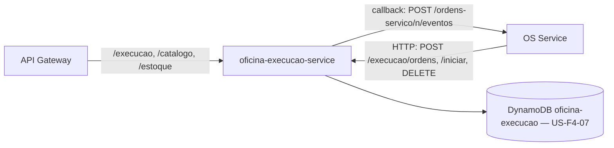

# **REPO**

[](https://github.com/guilhermeqmaia/soat-fiap-oficina-execucao-service/actions/workflows/ci.yml) [](https://github.com/guilhermeqmaia/soat-fiap-oficina-execucao-service/actions/workflows/cd-aws.yml)

****DESCRICAO**** — microsserviço do Sistema da Oficina Mecânica (Tech Challenge FIAP, Fase 4). Gerado pelo template do [`@guilhermeqmaia/oficina-kit`](https://github.com/guilhermeqmaia/soat-fiap-oficina-kit).

> Planejamento, RFCs/ADRs, contratos (HTTP interno e vocabulário AsyncAPI) e diagramas: [hub](https://github.com/guilhermeqmaia/soat-fiap-oficina-os-service/blob/main/docs/plano-execucao-fase-4.md).

## Responsabilidades

**Possui:** fila de execução das OS, diagnóstico (itens com preço congelado), **Catálogo** de serviços/produtos e **Estoque** (reservas e baixas com _conditional writes_). Banco próprio **DynamoDB** single-table `oficina-execucao` ([RFC-0007](https://github.com/guilhermeqmaia/soat-fiap-oficina-os-service/blob/main/docs/arquitetura/rfcs/RFC-0007-banco-nosql.md)).

**Não possui:** a OS e seu ciclo de vida (OS Service), orçamento/pagamento (Billing).

## Comunicação com os outros serviços

Decisão de **03/11/2026** ([RFC-0008](https://github.com/guilhermeqmaia/soat-fiap-oficina-os-service/blob/main/docs/arquitetura/rfcs), contrato completo em [`docs/contratos/http-interno.md`](https://github.com/guilhermeqmaia/soat-fiap-oficina-os-service/blob/main/docs/contratos/http-interno.md)): **sem mensageria** (SNS/SQS/LocalStack saíram). Os nomes e payloads dos comandos/eventos do [`asyncapi.yaml`](https://github.com/guilhermeqmaia/soat-fiap-oficina-os-service/blob/main/docs/contratos/asyncapi.yaml) seguem como vocabulário: cada comando do OS Service vira um endpoint HTTP **deste** serviço e cada evento vira a resposta síncrona desse endpoint ou um **callback** HTTP para o OS Service.

- **Quem chama quem:** o OS Service (orquestrador da saga, RFC-0005) chama este serviço; este serviço só chama o OS Service de volta, em `POST {OS_SERVICE_URL}/ordens-servico/{numero}/eventos` (envelope `{ id, type, version, occurredAt, producer, data }`). Retry 3x com backoff (200 ms, 800 ms, 3 s) só para `5xx`/timeout; `4xx` não repete.
- **Rede:** chamadas entre serviços **não passam pelo API Gateway** — vão pelo DNS interno do cluster (`OS_SERVICE_URL=http://oficina-app:3000`, Service `oficina-app` no namespace `oficina`; em dev, `http://localhost:3000`). O gateway continua sendo a única borda pública e roteia por prefixo ([infra-k8s/gateway](https://github.com/guilhermeqmaia/soat-fiap-oficina-infra-k8s/tree/main/gateway)).
- **Autenticação entre serviços:** JWT com `role: SERVICO` e `sub` = nome do serviço, assinado com o **mesmo `JWT_SECRET`** da Lambda (emitido localmente, `mintServiceToken` do kit). Endpoints internos e callbacks aceitam só `SERVICO`; endpoints de usuário continuam com os roles de hoje.
- **Idempotência:** comandos por `numeroOS` (repetir não duplica efeito). `409 { motivo }` = recusa de negócio (vira o evento de falha na saga); `404` = recurso desconhecido (não repete).
- **Correlação:** `x-correlation-id` (= número da OS) e `traceparent` propagados em toda chamada e callback (kit `logging`).

### Endpoints que a Execução expõe

| Endpoint                                                                           | Quem chama                         | Comando (vocabulário)       | Resposta = evento                                                                                       | Falha de negócio                                                |
| ---------------------------------------------------------------------------------- | ---------------------------------- | --------------------------- | ------------------------------------------------------------------------------------------------------- | --------------------------------------------------------------- |
| `POST /execucao/ordens` `{ numeroOS, veiculoId, descricaoProblema }`               | OS Service (`SERVICO`)             | `execucao.enfileirar`       | `201 { numeroOS, posicaoFila }` ≙ `execucao.enfileirada`                                                | `409 { motivo }` ≙ `execucao.recusada` (veículo já em execução) |
| `POST /execucao/ordens/{numeroOS}/iniciar`                                         | OS Service (`SERVICO`)             | `execucao.iniciar`          | `200 { numeroOS }` ≙ `execucao.iniciada` (baixa efetiva do estoque)                                     | `409 { motivo }` ≙ `execucao.recusada` (estoque insuficiente)   |
| `DELETE /execucao/ordens/{numeroOS}` `{ motivo }`                                  | OS Service (`SERVICO`)             | `execucao.liberar-reservas` | `200 { numeroOS }` ≙ `execucao.reservas-liberadas` (tira da fila, aborta diagnóstico, devolve reservas) | — (idempotente; `200` mesmo sem reservas)                       |
| `POST /execucao/ordens/{numeroOS}/diagnostico` (serviços + peças, reserva estoque) | Mecânico (`MECANICO`, via gateway) | —                           | `200` + callback `execucao.diagnostico-concluido`                                                       | `409` estoque insuficiente para reservar                        |
| `POST /execucao/ordens/{numeroOS}/finalizar`                                       | Mecânico (`MECANICO`, via gateway) | —                           | `200` + callback `execucao.finalizada`                                                                  | —                                                               |
| `/catalogo/*`, `/estoque/*`                                                        | Gestor/Mecânico (via gateway)      | —                           | CRUD de catálogo e estoque (US-F4-07)                                                                   | —                                                               |

### Callbacks que a Execução envia ao OS Service

`POST {OS_SERVICE_URL}/ordens-servico/{numeroOS}/eventos`, `producer: "execucao-service"`:

| `type`                           | Origem                          | `data`                                                                                                                                             |
| -------------------------------- | ------------------------------- | -------------------------------------------------------------------------------------------------------------------------------------------------- |
| `execucao.diagnostico-concluido` | mecânico concluiu o diagnóstico | `{ numeroOS, mecanicoId, diagnostico, itens[] }` (`Item`: `tipo`, `referenciaId`, `nome`, `quantidade`, `precoUnitario`, `servicoId` nos PRODUTOs) |
| `execucao.finalizada`            | mecânico finalizou a execução   | `{ numeroOS, finalizadaEm }`                                                                                                                       |

> Os endpoints acima são implementados nas US-F4-07/11; este scaffold só prepara a configuração (`OS_SERVICE_URL`) e remove a mensageria.

## Histórias

- [US-F4-04 — Repositórios dos serviços com CI/CD independente](https://github.com/guilhermeqmaia/soat-fiap-oficina-os-service/blob/main/docs/user-stories/f4-04-repos-e-cicd-por-servico.md) _(este scaffold)_
- [US-F4-07 — Fila de execução, diagnóstico, catálogo e estoque em DynamoDB](https://github.com/guilhermeqmaia/soat-fiap-oficina-os-service/blob/main/docs/user-stories/f4-07-execucao-service.md)
- [US-F4-11 — Compensações (liberar reservas)](https://github.com/guilhermeqmaia/soat-fiap-oficina-os-service/blob/main/docs/user-stories/f4-11-compensacoes-rollback.md)

> **Estado do scaffold:** gerado pelo template padrão (Postgres/Prisma, ainda sem modelos). A **US-F4-07** troca a persistência para DynamoDB (`@aws-sdk/lib-dynamodb`, _conditional writes_ para as reservas) e remove o Prisma — o restante (auth, logs, métricas, health, CI/CD) permanece.

## Execução local

```bash
cp .env.example .env
npm ci && npx prisma generate
npm run docker:up                 # Postgres próprio (sem broker — RFC-0008)
npx prisma migrate deploy
npm run start:dev                 # http://localhost:3002/api (Swagger)
```

Para os callbacks ao OS Service, suba o [OS Service](https://github.com/guilhermeqmaia/soat-fiap-oficina-os-service) localmente e aponte `OS_SERVICE_URL` (default `http://localhost:3000`).

Token para testar: a Lambda de auth (`POST {gateway}/auth`) ou, localmente, `mintToken` do kit (`@guilhermeqmaia/oficina-kit/testing`) com o mesmo `JWT_SECRET`.

## Testes e qualidade

```bash
npm run test:unit:cov        # gate 80% (jest.unit.config.js)
npm run test:integration     # e2e com Postgres via testcontainers
```

<!-- Evidências de cobertura: badge do SonarCloud + print em docs/evidencias/ -->

## Deploy

CD automático (`cd-aws.yml`): `homolog` → homologação, `main` → produção. Build → ECR → EKS (`k8s-aws/`) → migrations → smoke.

| Secret/var do repo                      | Uso                                                        |
| --------------------------------------- | ---------------------------------------------------------- |
| `AWS_ROLE_ARN` (secret)                 | OIDC da role `github-actions-oficina`                      |
| `EKS_CLUSTER_NAME`, `AWS_REGION` (vars) | cluster alvo                                               |
| `DB_SECRET_ID` (var)                    | segredo do banco **próprio** no Secrets Manager (infra-db) |
| `JWT_SECRET_ID` (var)                   | segredo HS256 compartilhado com a Lambda                   |

O Service expõe o **NodePort `30082`**, alvo do target group deste serviço no NLB interno único (ADR-0013). `OS_SERVICE_URL` é fixo no [`k8s/configmap.yaml`](k8s/configmap.yaml) (`http://oficina-app:3000`, DNS interno do cluster).

## Arquitetura do serviço


