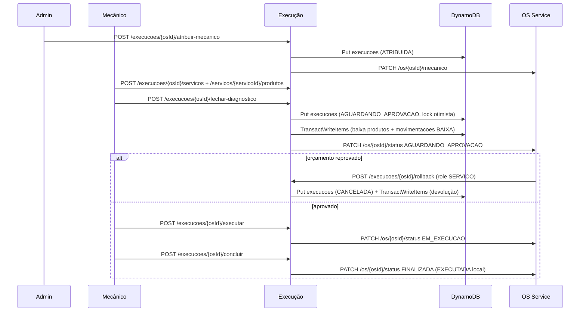

# oficina-execucao-service

[](https://github.com/engineercodeprojects/fase-04-soat-fiap-oficina-execucao-service/actions/workflows/ci.yml)

Microsserviço **Execução** da Oficina Mecânica (Tech Challenge FIAP, Fase 4). Cuida da **execução das Ordens de Serviço (OS)**: atribuição de mecânico, diagnóstico (serviços + peças), catálogo de serviços e produtos, **estoque com baixa e devolução (rollback) transacionais** e o ciclo de vida da execução. A OS em si (dados e status oficial) pertence ao **OS Service** (`fase-04-soat-fiap-oficina-os-service`), acessado por HTTP.

- NestJS 11 + TypeScript, DDD por módulo (`src/<modulo>/{domain,application,infrastructure}`), linguagem ubíqua em português.
- Banco próprio **AWS DynamoDB** (SDK v3 `@aws-sdk/client-dynamodb` + `@aws-sdk/lib-dynamodb`).
- Auth resource-server (JWT HS256 da auth-lambda) e logs/métricas/health do [`@guilhermeqmaia/oficina-kit`](https://github.com/guilhermeqmaia/soat-fiap-oficina-kit).
- Swagger em **`/api/docs`** (fora de produção).

## Arquitetura

```
src/
├── dynamodb/      cliente DynamoDB, nomes de tabelas (env), health, definição/criação de tabelas (dev/teste)
├── servico/       catálogo de serviços (CRUD /servicos)
├── produto/       catálogo de produtos + estoque (CRUD /produtos, entradas, movimentações,
│                  EstoqueService: baixa/devolução com TransactWriteItems)
├── execucao/      agregado Execução (1 por OS), máquina de estados, rotas /execucoes,
│                  OsServiceClient (porta OsServiceGateway + adapter HTTP axios)
└── shared/        erros de domínio e validações comuns; teste de arquitetura (regra de dependência)
```

| Camada           | Conteúdo                                                                               | Pode depender de                                    |
| ---------------- | -------------------------------------------------------------------------------------- | --------------------------------------------------- |
| `domain`         | Entidades (`Execucao`, `Produto`, `Servico`), regras puras de estoque, portas (repos)  | nada de Nest/infra (só `oficina-kit/core` e `auth`) |
| `application`    | Casos de uso, `EstoqueService`, porta `OsServiceGateway`                               | `domain`, `@nestjs/common`                          |
| `infrastructure` | Controllers + DTOs (class-validator/Swagger), repositórios DynamoDB, `OsServiceClient` | tudo                                                |

`src/shared/architecture.spec.ts` quebra o build se a regra de dependência for violada. Erros de domínio (`DomainError`) viram HTTP no `DomainExceptionFilter` do kit (400/403/404/409); OS Service indisponível vira **502**.

## Modelo de dados (DynamoDB)

Nome físico = `DYNAMODB_TABLE_PREFIX` + nome base (ou override completo `DYNAMODB_TABLE_<TABELA>`). A aplicação **assume que as tabelas existem**: em produção elas vêm do Terraform do `fase-04-soat-fiap-oficina-infra-db`; em dev/teste, do script `npm run dynamodb:create-tables`. As definições de referência (chaves e GSIs) ficam em [`src/dynamodb/definicoes-tabelas.ts`](src/dynamodb/definicoes-tabelas.ts).

| Tabela                  | Chave                   | GSIs                                                                           | Item                                                                                                     |
| ----------------------- | ----------------------- | ------------------------------------------------------------------------------ | -------------------------------------------------------------------------------------------------------- |
| `execucoes`             | `osId` (HASH)           | —                                                                              | `{ osId, mecanicoId, status, servicos[], estoqueBaixado, createdAt, updatedAt, versao }`                 |
| `servicos`              | `servicoId` (HASH)      | —                                                                              | `{ servicoId, nome, descricao, precoBase, createdAt, updatedAt }`                                        |
| `produtos`              | `produtoId` (HASH)      | —                                                                              | `{ produtoId, nome, sku, preco, quantidadeEstoque, createdAt, updatedAt }`                               |
| `movimentacoes_estoque` | `movimentacaoId` (HASH) | `osId-data-index` (`osId`+`data`), `produtoId-data-index` (`produtoId`+`data`) | `{ movimentacaoId, produtoId, tipo (ENTRADA \| BAIXA \| DEVOLUCAO), quantidade, osId, servicoId, data }` |

- `servicos[]` da execução é um **snapshot**: `{ servicoId, nome, preco, produtos: [{ produtoId, nome, sku, precoUnitario, quantidade }] }` — preço congelado no vínculo; editar/remover o catálogo não altera OS em andamento.
- `versao` = **lock otimista** (`ConditionExpression: versao = :lida`): duas operações concorrentes na mesma OS → a segunda recebe `409`.
- O GSI `osId-data-index` sustenta o rollback (todas as movimentações da OS); `produtoId-data-index`, o extrato por produto. Movimentações `ENTRADA` (sem OS) não têm `osId` e ficam fora do índice por OS.
- Listagens do catálogo usam `Scan` paginado (catálogos pequenos); unicidade de SKU é checada por `Scan` — para escalar, um GSI em `sku` no infra-db.

### Transações de estoque

Baixa, devolução e entrada usam **um único `TransactWriteItems`** (tudo ou nada) — [`dynamodb-estoque.repository.ts`](src/produto/infrastructure/dynamodb-estoque.repository.ts):

1. Um `Update` por **produto** em `produtos` com `SET quantidadeEstoque = quantidadeEstoque + :delta` (o delta é consolidado por produto, pois o DynamoDB não aceita duas operações no mesmo item numa transação — e um produto pode atender vários serviços da OS):
   - `ConditionExpression: attribute_exists(produtoId) AND quantidadeEstoque >= :necessario` na baixa → **o saldo nunca fica negativo**, mesmo com concorrência;
2. Um `Put` por movimentação em `movimentacoes_estoque` (uma por produto × serviço, para rastrear qual serviço consumiu a peça), com `attribute_not_exists(movimentacaoId)`.

Se qualquer condição falhar, nada é gravado; `CancellationReasons` (com `ReturnValuesOnConditionCheckFailure: ALL_OLD`) é traduzido para `EstoqueInsuficienteError` (409, com saldo disponível) ou `ProdutoNaoEncontradoError` (404). Antes da transação, o domínio (`validarSaldo`) já valida o saldo para dar a mensagem clara; a condição do banco é a garantia final. Limite: 100 itens por transação.

**Devolução (rollback)** é calculada pelo **líquido do histórico da OS** (Σ BAIXA − Σ DEVOLUCAO por produto × serviço): repetir o rollback não devolve em dobro (idempotente para retries do OS Service).

## Máquina de estados da execução

```
ATRIBUIDA ──► EM_DIAGNOSTICO ──► AGUARDANDO_APROVACAO ──► EM_EXECUCAO ──► EXECUTADA
    │               │                    │
    └───────────────┴────────────────────┴──► CANCELADA (rollback / orçamento reprovado)
```

`ATRIBUIDA → AGUARDANDO_APROVACAO` também é permitido (fechar o diagnóstico sem marcar `EM_DIAGNOSTICO`). Serviços e peças só podem ser alterados em `ATRIBUIDA`/`EM_DIAGNOSTICO`. `EXECUTADA` e `CANCELADA` são finais.

## Fluxo ponta a ponta



**Consistência com o OS Service:** cada operação grava primeiro o estado local (o lock otimista serializa operações concorrentes e impede baixa em dobro) e só então propaga. Se a propagação falhar, o estado local é **restaurado** e, no fechamento do diagnóstico, as peças são **devolvidas** ao estoque. Resposta: `409` se o OS Service recusou (4xx, mensagem com o `motivo`), `502` se ficou indisponível (timeout/rede/5xx após retries).

## Integração com o OS Service

O `OsServiceClient` ([`os-service.client.ts`](src/execucao/infrastructure/os-service/os-service.client.ts)) implementa a porta `OsServiceGateway` com axios:

- `atribuirMecanico` → `PATCH {OS_SERVICE_URL}/os/{osId}/mecanico` body `{ "mecanicoId": "..." }`
- `atualizarStatus` → `PATCH {OS_SERVICE_URL}/os/{osId}/status` body `{ "status": "..." }`
- Auth: JWT de serviço (`role: SERVICO`, `sub: execucao-service`, mesmo `JWT_SECRET`, `EmissorTokenServico` do kit); header `x-correlation-id` = `osId`.
- Retry com backoff (200 ms, 400 ms, ...) só para timeout/rede/5xx; 4xx não repete.

> **Atenção — contrato a alinhar.** Na data desta implementação o `os-service` **não expõe** `PATCH /os/{id}/mecanico` nem `PATCH /os/{id}/status`: ele orquestra a saga (RFC-0008, `docs/contratos/http-interno.md`) chamando `POST /execucao/ordens`, `POST /execucao/ordens/{numeroOS}/iniciar` e `DELETE /execucao/ordens/{numeroOS}`, e recebe callbacks em `POST /ordens-servico/{numero}/eventos`. Por isso o cliente é **isolado e configurável** — método, paths e mapa de status vêm do ambiente, sem mudar código:

| Variável                   | Default                      | Uso                                                                              |
| -------------------------- | ---------------------------- | -------------------------------------------------------------------------------- |
| `OS_SERVICE_HTTP_METHOD`   | `PATCH`                      | `PATCH`, `POST` ou `PUT`                                                         |
| `OS_SERVICE_MECANICO_PATH` | `/os/{osId}/mecanico`        | `{osId}` é substituído (URL-encoded)                                             |
| `OS_SERVICE_STATUS_PATH`   | `/os/{osId}/status`          |                                                                                  |
| `OS_SERVICE_STATUS_MAP`    | `{"EXECUTADA":"FINALIZADA"}` | JSON status local → status da OS (demais enviados iguais; a OS usa `FINALIZADA`) |
| `OS_SERVICE_TIMEOUT_MS`    | `5000`                       |                                                                                  |
| `OS_SERVICE_RETRIES`       | `2`                          | retries extras para 5xx/timeout                                                  |

## Rotas e roles

Todas exigem `Authorization: Bearer <JWT>` (HS256, claims `sub`, `cpf`, `role`, `iss`, `exp`, validado com `JWT_SECRET`/`JWT_ISSUER`). Um `MECANICO` só opera execuções atribuídas a ele (`sub` = `mecanicoId`), senão `403`.

| Método e rota                                        | Roles                       | Descrição                                                                |
| ---------------------------------------------------- | --------------------------- | ------------------------------------------------------------------------ |
| `POST /execucoes/:osId/atribuir-mecanico`            | ADMIN                       | Cria a execução (ou reatribui durante o diagnóstico) e propaga           |
| `GET /execucoes` `?mecanicoId&status`                | ADMIN, MECANICO             | Fila (MECANICO vê só as suas)                                            |
| `GET /execucoes/:osId`                               | ADMIN, MECANICO, SERVICO    | Detalhe + `valorTotal` (mão de obra + peças)                             |
| `PATCH /execucoes/:osId/status`                      | MECANICO, ADMIN             | `EM_DIAGNOSTICO`, `EM_EXECUCAO`, `EXECUTADA` (+ propaga)                 |
| `POST /execucoes/:osId/servicos`                     | MECANICO, ADMIN             | Vincula N serviços do catálogo                                           |
| `DELETE /execucoes/:osId/servicos/:servicoId`        | MECANICO, ADMIN             | Desvincula serviço                                                       |
| `POST /execucoes/:osId/servicos/:servicoId/produtos` | MECANICO, ADMIN             | Vincula peças ao serviço (um produto pode atender vários serviços)       |
| `POST /execucoes/:osId/fechar-diagnostico`           | MECANICO, ADMIN             | Baixa no estoque (transação) + OS → `AGUARDANDO_APROVACAO`               |
| `POST /execucoes/:osId/rollback`                     | SERVICO, ADMIN              | Orçamento reprovado: devolve peças e marca `CANCELADA`                   |
| `POST /execucoes/:osId/executar`                     | MECANICO, ADMIN             | `EM_EXECUCAO` + propaga                                                  |
| `POST /execucoes/:osId/concluir`                     | MECANICO, ADMIN             | `EXECUTADA` + propaga                                                    |
| `GET /execucoes/:osId/movimentacoes`                 | ADMIN, ESTOQUISTA, MECANICO | Movimentações de estoque da OS                                           |
| `POST /servicos`, `PATCH/DELETE /servicos/:id`       | ADMIN                       | Catálogo de serviços                                                     |
| `GET /servicos`, `GET /servicos/:id`                 | ADMIN, MECANICO, ESTOQUISTA |                                                                          |
| `POST /produtos`, `PATCH /produtos/:id`              | ADMIN, ESTOQUISTA           | Catálogo de produtos (saldo inicial na criação; PATCH não mexe no saldo) |
| `DELETE /produtos/:id`                               | ADMIN                       |                                                                          |
| `GET /produtos`, `GET /produtos/:id`                 | ADMIN, ESTOQUISTA, MECANICO |                                                                          |
| `POST /produtos/:id/entradas`                        | ADMIN, ESTOQUISTA           | Reposição (movimentação `ENTRADA`, transacional)                         |
| `GET /produtos/:id/movimentacoes`                    | ADMIN, ESTOQUISTA           | Extrato do produto                                                       |
| `GET /health`, `/health/ready`, `/metrics`           | público                     | Liveness, readiness (`DescribeTable`), Prometheus                        |

## Variáveis de ambiente

| Variável                                                                          | Obrigatória     | Descrição                                                                              |
| --------------------------------------------------------------------------------- | --------------- | -------------------------------------------------------------------------------------- |
| `JWT_SECRET`                                                                      | sim             | Segredo HS256 compartilhado com a auth-lambda (≥ 32 chars em produção)                 |
| `JWT_ISSUER`                                                                      | não             | `iss` esperado (ex.: `oficina-auth-lambda`)                                            |
| `OS_SERVICE_URL`                                                                  | sim em produção | Base do OS Service. Vazio em dev = propagação desligada (só log)                       |
| `OS_SERVICE_*`                                                                    | não             | Contrato configurável (tabela acima)                                                   |
| `AWS_REGION`                                                                      | não             | Default `us-east-1`                                                                    |
| `DYNAMODB_ENDPOINT`                                                               | não             | Endpoint do DynamoDB Local (`http://localhost:8000`). Vazio = AWS (credenciais do pod) |
| `DYNAMODB_TABLE_PREFIX`                                                           | não             | Prefixo dos nomes das tabelas (ex.: `oficina-`)                                        |
| `DYNAMODB_TABLE_EXECUCOES` / `_SERVICOS` / `_PRODUTOS` / `_MOVIMENTACOES_ESTOQUE` | não             | Nome completo de uma tabela (vence o prefixo)                                          |
| `PORT`, `LOG_LEVEL`, `DD_*`                                                       | não             | Porta (3002), log, APM                                                                 |

Veja [`.env.example`](.env.example).

## Rodando localmente (DynamoDB Local)

```bash
cp .env.example .env               # ajuste JWT_SECRET
npm ci
docker compose up -d dynamodb      # DynamoDB Local em :8000 (dados em volume)
npm run dynamodb:create-tables     # cria as 4 tabelas com o prefixo do .env (idempotente)
npm run start:dev                  # http://localhost:3002/api/docs
# opcional: UI do DynamoDB em http://localhost:8001
docker compose --profile admin up -d dynamodb-admin
```

`npm run docker:up` faz os dois primeiros passos. O script `create-tables` recusa rodar sem `DYNAMODB_ENDPOINT` (proteção contra criar tabelas na AWS; force com `ALLOW_AWS_CREATE_TABLES=true`).

Token de teste (mesmo segredo do `.env`):

```bash
export JWT_SECRET=...   # o mesmo do .env
ADMIN=$(node -e "console.log(require('@guilhermeqmaia/oficina-kit/testing').mintToken({sub:'adm-1',role:'ADMIN'}))")
MEC=$(node -e "console.log(require('@guilhermeqmaia/oficina-kit/testing').mintToken({sub:'mec-1',role:'MECANICO'}))")
EST=$(node -e "console.log(require('@guilhermeqmaia/oficina-kit/testing').mintToken({sub:'est-1',role:'ESTOQUISTA'}))")
SVC=$(node -e "console.log(require('@guilhermeqmaia/oficina-kit/testing').mintServiceToken({servico:'os-service'}))")
API=http://localhost:3002
```

## Exemplos de curl

```bash
# Catálogo
curl -s -X POST $API/servicos -H "Authorization: Bearer $ADMIN" -H 'Content-Type: application/json' \
  -d '{"nome":"Troca de oleo","descricao":"Oleo + filtro","precoBase":120}'
curl -s $API/servicos -H "Authorization: Bearer $MEC"
curl -s -X PATCH $API/servicos/$SERVICO_ID -H "Authorization: Bearer $ADMIN" -H 'Content-Type: application/json' -d '{"precoBase":130}'
curl -s -X DELETE $API/servicos/$SERVICO_ID -H "Authorization: Bearer $ADMIN"

curl -s -X POST $API/produtos -H "Authorization: Bearer $EST" -H 'Content-Type: application/json' \
  -d '{"nome":"Oleo 5W30 1L","sku":"OL-5W30","preco":45.9,"quantidadeEstoque":10}'
curl -s -X POST $API/produtos/$PRODUTO_ID/entradas -H "Authorization: Bearer $EST" -H 'Content-Type: application/json' -d '{"quantidade":5}'
curl -s $API/produtos/$PRODUTO_ID/movimentacoes -H "Authorization: Bearer $EST"

# Execução da OS 42
curl -s -X POST $API/execucoes/42/atribuir-mecanico -H "Authorization: Bearer $ADMIN" -H 'Content-Type: application/json' -d '{"mecanicoId":"mec-1"}'
curl -s -X PATCH $API/execucoes/42/status -H "Authorization: Bearer $MEC" -H 'Content-Type: application/json' -d '{"status":"EM_DIAGNOSTICO"}'
curl -s -X POST $API/execucoes/42/servicos -H "Authorization: Bearer $MEC" -H 'Content-Type: application/json' -d "{\"servicoIds\":[\"$SERVICO_ID\"]}"
curl -s -X POST $API/execucoes/42/servicos/$SERVICO_ID/produtos -H "Authorization: Bearer $MEC" -H 'Content-Type: application/json' \
  -d "{\"produtos\":[{\"produtoId\":\"$PRODUTO_ID\",\"quantidade\":4}]}"
curl -s -X POST $API/execucoes/42/fechar-diagnostico -H "Authorization: Bearer $MEC"   # baixa no estoque
curl -s $API/execucoes/42 -H "Authorization: Bearer $MEC"                              # valorTotal = orçamento

# Orçamento reprovado (chamado pelo OS Service)
curl -s -X POST $API/execucoes/42/rollback -H "Authorization: Bearer $SVC"

# ...ou aprovado
curl -s -X POST $API/execucoes/42/executar -H "Authorization: Bearer $MEC"
curl -s -X POST $API/execucoes/42/concluir -H "Authorization: Bearer $MEC"
curl -s "$API/execucoes?status=EXECUTADA" -H "Authorization: Bearer $ADMIN"
```

## Testes

```bash
npm run test:unit:cov      # domínio + casos de uso + OsServiceClient (gate 80%)
npm run test:integration   # e2e: AppModule real + DynamoDB Local + mock HTTP do OS Service
```

- **Unitários:** máquina de estados, agregado `Execucao`, validação de saldo, planejamento de baixa/devolução (idempotência), casos de uso com fakes (compensações quando o OS falha, concorrência), `OsServiceClient` contra um servidor HTTP fake (paths, mapa de status, retry, 4xx/5xx).
- **e2e** (`*.e2e.spec.ts`): sobe `amazon/dynamodb-local` via testcontainers (ou usa `DYNAMODB_ENDPOINT` se definido, ex. `docker compose up -d dynamodb`), cria as tabelas com prefixo próprio e cobre: fluxo feliz completo, estoque insuficiente (nada baixado), rollback idempotente, OS Service fora do ar (502 + devolução), roles por rota, CRUDs.

## Deploy

- `Dockerfile` multi-stage; sem migrações no boot (tabelas são do Terraform).
- `k8s/` (kustomize) + overlay `k8s-aws/` (EKS). O ConfigMap define `DYNAMODB_TABLE_PREFIX`/`AWS_REGION`/`OS_SERVICE_URL`; o único Secret é `JWT_SECRET`. Acesso ao DynamoDB pelas credenciais do nó/pod (`LabRole` no AWS Academy).
- **Pendência no `infra-db`:** o `dynamodb.tf` atual cria uma tabela single-table `oficina-execucao` (PK/SK + GSIs, RFC-0007). Este serviço usa as 4 tabelas acima — o Terraform precisa criá-las (chaves e GSIs de `src/dynamodb/definicoes-tabelas.ts`) com o mesmo prefixo do ConfigMap.
